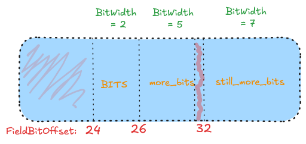

## Introduction

I’ve been contributing to LLVM through the [ClangIR project](https://llvm.github.io/clangir/). ClangIR is a new intermediate representation (IR) for Clang, built on top of MLIR. It introduces a dedicated MLIR dialect for representing C/C++ programs in a more structured and extensible way. If you’re curious to learn more about ClangIR, I highly recommend watching this [introductory talk on YouTube](https://www.youtube.com/watch?v=XNOPO3ogdfQ).

While working on upstreaming support for bitfields, we noticed a discrepancy between the layout generated by ClangIR and the one produced by the classic LLVM CodeGen. This divergence started around [this commit](https://github.com/llvm/llvm-project/pull/65742), following a key change in how bitfields are accumulated.

To address this, I worked on updating the accumulation algorithm in ClangIR to match the behavior of CodeGen. This update was submitted in [this pull request](https://github.com/llvm/llvm-project/pull/142041), which I’ll walk through in this blog post.

Before diving into the details of the algorithm, let’s first briefly explain what a bitfield is in C and C++.

## What is a Bitfield?

A [bitfield](https://en.wikipedia.org/wiki/Bit_field) in C or C++ is a member variable typically of an integer type (signed or unsigned) where the number of bits allocated to it is explicitly specified by the programmer. This allows for more memory-efficient representations, especially when you want to pack multiple small width values into a single storage unit.

For example, consider the following structure (which also appears in the pull request mentioned above):

```c
struct S {
  char a, b, c;
  unsigned bits : 2;
  unsigned more_bits : 5;
  unsigned still_more_bits : 7;
};
```

In this example:

* `a`, `b`, and `c` are regular `char` fields.
* `bits`, `more_bits`, and `still_more_bits` are `unsigned` bitfields with explicit bit-widths of **2**, **5**, and **7** bits respectively.

This means that instead of allocating a full `unsigned int` (typically 32 bits) for each member, the compiler will attempt to pack them tightly into `storage units` according to their`bit-widths`.

We’re keeping this explanation simple bitfields can also be volatile, appear inside unions, or be subject to alignment constraints. For instance, zero-width bitfields like int a : 0; are commonly used to force alignment to the next storage unit boundary, which affects how subsequent fields are laid out. These cases are important for ABI conformance, but are outside the scope of this post. Here, we'll focus only on the most basic case: consecutive bitfields inside a struct, without zero-width or special qualifiers..

## What Was the Problem?

Let’s go back to our previous struct example and try to reason using simple math how these bitfields *should* be packed. The bitfields have widths of 2, 5, and 7 bits, which sum to a total of **14 bits**. This means they can ideally be packed into a single 16-bit integer (e.g., an `i16`), since 16 bits are sufficient to store all three fields together.

So, the ideal output layout from the compiler should look something like this (this is what CodeGen outputs):

```llvm
%struct.S = type <{ i8, i8, i8, i16, [3 x i8] }>
```

Here’s what each field represents:

* The first three `i8` values correspond to the regular `char a`, `char b`, and `char c`.
* The `i16` groups all the bitfields (`bits`, `more_bits`, `still_more_bits`) into one storage unit.
* The `[3 x i8]` padding ensures the struct is properly aligned according to ABI rules.

However, the output we were seeing from **ClangIR** looked like this instead:

```llvm
%struct.S = type { i8, i8, i8, i8, i8, [3 x i8] }
```

And in CIR dialect, it looked even more verbose:

```mlir
!rec_S = !cir.record<struct "S" padded {
!s8i, !s8i, !s8i, !u8i, !u8i, !cir.array<!u8i x 3>
}>
```

Here’s the breakdown:

* `a`, `b`, and `c` are still `i8`s (or `!s8i` in CIR).
* `bits` and `more_bits` were placed into the first `u8i`.
* `still_more_bits`, although only 7 bits, was placed into its own separate `u8i` storage unit.
* Then came the padding for alignment.

This discrepancy needed to be addressed to ensure that ClangIR would emit data layouts consistent with what LLVM’s CodeGen. That’s where the updated bitfield accumulation algorithm comes in—which we’ll now explore.

## Why Couldn't We Accumulate Bitfields Properly?

This blog focuses on the new bitfield accumulation algorithm, so we won’t dive deeply into the old implementation. However, it’s important to understand **why** the previous approach failed in some cases.

The issue is that the previous algorithm **wasn’t able to correctly handle non-contiguous bitfields**—that is, bitfields that are not tightly packed due to alignment or padding requirements introduced by the data layout.

You can clearly see the problem in the following layout image:



Let’s break it down:

* The struct has three `char` fields: `a`, `b`, and `c`, each 8 bits in size.
* These take up the first 24 bits (3 × 8 = 24), so the first bitfield (`bits`) starts at **offset 24**.
* The next bitfield, `more_bits`, starts at **offset 26** and has a bit-width of 5 bits.
* Ideally, we’d expect the next bitfield (`still_more_bits`) to start at offset 31 (i.e., immediately after `more_bits` ends).

However, that’s not what happens the `still_more_bits` field actually starts at **offset 32**, meaning **one bit is skipped**, and the bitfields are no longer packed tightly. This breaks the assumption of contiguity that the old algorithm relied on.

This is exactly where the previous implementation failed: it didn’t account for alignment gaps or padding that might appear **between** bitfields.

## How Does the New Algorithm Work?

The core of the updated bitfield accumulation logic lives inside the method:

```cpp
CIRRecordLowering::accumulateBitFields
```

This function takes two arguments:

```cpp
RecordDecl::field_iterator field,
RecordDecl::field_iterator fieldEnd
```

These represent:

* `field`: the **first** occurrence of a bitfield in a contiguous sequence.
* `fieldEnd`: the **end** of that contiguous sequence of bitfield declarations.

In our working example (the `struct S` we’ve been using), `field` would point to `bits`, and `fieldEnd` would point **after** `still_more_bits`, which is the last bitfield in the struct.

But before we can call `accumulateBitFields`, we first need to determine where a sequence of bitfields begins and ends. This is done by iterating through all the fields in the structure, using Clang’s [`RecordDecl`](https://clang.llvm.org/doxygen/classclang_1_1RecordDecl.html), which represents the declaration of a `struct`, `class`, or `union`.

Here’s the relevant loop:

```cpp hl="1 4 9"
  for (RecordDecl::field_iterator field = recordDecl->field_begin(),
                                  fieldEnd = recordDecl->field_end();
       field != fieldEnd;) {
    if (field->isBitField()) {
      RecordDecl::field_iterator start = field;
      // Iterate to gather the list of bitfields.
      for (++field; field != fieldEnd && field->isBitField(); ++field)
        ;
      field = accumulateBitFields(start, field);
      assert((field == fieldEnd || !field->isBitField()) &&
             "Failed to accumulate all the bitfields");
...
```

### What This Loop Does:

1. **Walks over each field** in the record (struct).
2. When it encounters a field that is a bitfield (`field->isBitField()`), it:

   * Marks it as the **start** of a potential accumulation (`start = field`).
   * Continues advancing the iterator until it finds a non-bitfield field or the end of the fields.
3. Once the contiguous block of bitfields ends, it calls `accumulateBitFields(start, field)` to process and pack those fields accordingly.

## Initializing the Accumulation Run

Once we enter the `accumulateBitFields` function, the first step is to initialize several variables that are crucial for tracking the current bitfield accumulation run and making decisions about when to **flush** (i.e., stop accumulating) and start a new run.

Here’s the relevant snippet:

```cpp
  CharUnits regSize =
      bitsToCharUnits(astContext.getTargetInfo().getRegisterWidth());
  unsigned charBits = astContext.getCharWidth();

  // Begin is the first bitfield of the current span.
  // If Begin == FieldEnd, we’re not currently in an active accumulation.
  RecordDecl::field_iterator begin = fieldEnd;
  CharUnits beginOffset;
  uint64_t bitSizeSinceBegin;

  // BestEnd marks the (non-inclusive) end of the best accumulation so far.
  // It may extend past the last field, if alignment allows it.
  RecordDecl::field_iterator bestEnd = begin;
  CharUnits bestEndOffset;
```

### What These Variables Are For:

* **`RegSize`**: This holds the target register size in *bytes*. It's used to ensure we don’t accumulate more bits than what can be read in a single efficient load instruction on the target architecture.

* **`CharBits`**: Number of bits in a `char`. Usually 8, but abstracted here via the AST context for portability.

* **`Begin`**: Points to the first bitfield in the current accumulation run. If `Begin == FieldEnd`, we know we haven’t started a run yet.

* **`BeginOffset`**: The offset of the first bitfield in the current run (in characters). This allows us to compute how wide the accumulated region is.

* **`BitSizeSinceBegin`**: Keeps track of the total number of bits we’ve accumulated in the current run. This is critical for determining whether we've exceeded the register size.

## Walking Through the Accumulation Loop

With all the necessary setup in place, we now enter the core loop that walks over the range of bitfields and decides how to accumulate them efficiently.

To demonstrate how the algorithm behaves, let’s reuse the following example:

```c
struct S {
  char a, b, c;
  unsigned bits : 2;
  unsigned more_bits : 5;
  unsigned still_more_bits : 7;
};
```
* `atAlignedBoundary`: Becomes `true` when a field starts a new aligned block.
* `barrier`: Indicates an interruption in the accumulation, such as a **zero-width bitfield** or a **non-bitfield**. While we expect all fields in the accumulation run to be bitfields (based on how we group them), we still check this to be safe.

This loop lives inside the `accumulateBitFields` function, and here’s how it begins:

```cpp hl="4 6 8 14 17"
 for (;;) {
    // atAlignedBoundary is true if 'field' is the (potential) start of a new
    // span (or the end of the bitfields).
    bool atAlignedBoundary = false;
    bool barrier = false; // a barrier can be a zero Bit Width or non bit member
    if (field != fieldEnd && field->isBitField()) {
      uint64_t bitOffset = getFieldBitOffset(*field);
      if (begin == fieldEnd) {
        // Beginning a new span.
        begin = field;
        bestEnd = begin;
        beginOffset = bitsToCharUnits(bitOffset);
        bitSizeSinceBegin = 0;
      } else if ((bitOffset % charBits) != 0) {
        // Bitfield occupies the same character as previous bitfield, it must be
        // part of the same span.
      } else {
        // Bitfield potentially begins a new span. This includes zero-length
        // bitfields on non-aligning targets that lie at character boundaries
        // (those are barriers to merging).
        if (field->isZeroLengthBitField())
          barrier = true;
        atAlignedBoundary = true;
      }
    } else {
      // We've reached the end of the bitfield run. Either we're done, or this
      // is a barrier for the current span.
      if (begin == fieldEnd)
        break;

      barrier = true;
      atAlignedBoundary = true;
    }

}
```

### Explanation of Key Concepts:

####  `field != fieldEnd && field->isBitField()`

This ensures we're still inside the valid range and that the current field is a bitfield. If not, we likely hit the end of the span or a non-bitfield — in either case, we may need to flush the current run.

####  `begin == fieldEnd`

This condition tells us we’re **not currently accumulating** any bitfield run. So, we initialize:

* `begin` with the current field (the start of the span),
* `bestEnd` to this field as well,
* `beginOffset` to the field’s offset,
* and `bitSizeSinceBegin` to 0.

This starts a new accumulation.

####  `(bitOffset % CharBits) != 0`

This checks whether the current bitfield shares a byte with the previous one. If it does, it means it's part of the **same physical character**, so we can safely continue the span.

If this condition is **false**, the bitfield is **aligned at a byte boundary**. This might mean we should **start a new span**, but we need more information—specifically:

####  `field->isZeroLengthBitField()`

A **zero-width bitfield** (e.g., `int : 0;`) forces alignment and breaks accumulation. In this case, we mark `barrier = true` and set `atAlignedBoundary = true`.

This creates a **barrier**, signaling the end of the current span and the start of a new one.

####  Else branch (non-bitfield)

If the field is not a bitfield (though this shouldn't happen in theory due to earlier logic), we conservatively assume a barrier and prepare to flush.

---

In this first iteration of the loop, assuming `bits` is at offset 24, and we’re just starting accumulation, the following happens:

* We set `begin = field` (which is `bits`),
* `bestEnd = begin`,
* `bitSizeSinceBegin = 0`,
* and `beginOffset = 3` bytes (since 24 bits = 3 bytes).

This sets up the first span of bitfield accumulation, and the loop will now move to `more_bits` and eventually `still_more_bits`, checking whether they continue the run or trigger a flush.

